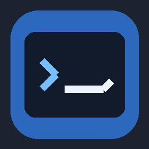

# Tabword
<<<<<<< HEAD

**Terminal-style word completion for Visual Studio Code.**

Tabword completes the word you're typing using words that already exist in the
current file. No floating IntelliSense menu, no distracting popup, and no
project-wide indexing.

<p align="center">
  
</p>

## Why Tabword?

In a terminal, you can often type the beginning of a word and press `Tab` to
finish it. Tabword brings a similar workflow to the VS Code editor.

For example, if your file already contains:

```python
database_connection = connect_to_database()
```

and you start typing this elsewhere in the same file:

```python
database_con
```

press `Tab` to complete the word to `database_connection`.

## Features

- **Quiet completion:** no suggestion popup is opened.
- **Current-file matching:** uses words found in the active document.
- **Cycle through matches:** press `Tab` again to move to the next match.
- **Go backwards:** press `Shift + Tab` to move to the previous match.
- **Indentation-friendly:** when Tabword has no matching completion, VS Code keeps
  its normal `Tab` and `Shift + Tab` behavior.
- **No external runtime:** once installed, you do not need Node.js, npm, Python,
  a separate configuration file, or manual `settings.json` changes.

## Install

### Install from a VSIX file

1. Download the `tabword-0.1.1.vsix` release file.
2. Open **Visual Studio Code**.
3. Open the Command Palette with `Ctrl + Shift + P` (`Cmd + Shift + P` on macOS).
4. Run **Extensions: Install from VSIX...**.
5. Select the downloaded `tabword-0.1.1.vsix` file.
6. Reload VS Code if prompted.

That's it. Tabword is ready to use.

> **Note:** The VSIX is the installable extension package. You do not need to
> extract it, open a terminal, run npm, or compile anything.

### Find it in the Marketplace

Marketplace publication is planned. Until the extension has a verified
Marketplace listing, install it using the VSIX instructions above.

## How to use it

1. Open a file in VS Code.
2. Make sure the file contains a longer word you want to reuse.
3. Start typing the beginning of that word on another line.
4. Press `Tab` to complete it.
5. If more than one matching word exists, press `Tab` to cycle forward or
   `Shift + Tab` to cycle backward.

### Keyboard shortcuts

| Shortcut | Action |
| --- | --- |
| `Tab` | Complete / cycle to the next matching word |
| `Shift + Tab` | Cycle to the previous matching word |

Tabword only takes over these keys while a matching completion is available.
Otherwise, the editor's normal indentation behavior remains in effect.

## What Tabword searches

Tabword searches the **active document only**. It does not search other open
files, folders, or your entire workspace.

It currently recognizes identifier-style words made from:

- Letters (`a-z`, `A-Z`)
- Numbers (`0-9`)
- Underscores (`_`)
- Dollar signs (`$`)

It is a lightweight word matcher, not a language parser. Matches may therefore
come from comments, strings, or code.

## Settings and configuration

No configuration is required.

Tabword does not need you to enable VS Code's suggestion popup. It is designed
to work without the floating IntelliSense suggestion box. It also does not
require you to change your indentation size or formatting settings.

If you have customized keyboard shortcuts, another extension may take priority.
Open **File → Preferences → Keyboard Shortcuts** (or press `Ctrl + K`, then
`Ctrl + S`) and search for:

- `Tabword: Complete Next`
- `Tabword: Complete Previous`

## Troubleshooting

### Tab inserts indentation instead of completing a word

Tabword only intercepts `Tab` when it finds a longer matching word in the
current document. Check that:

- The word you're trying to complete already appears elsewhere in the same file.
- Your cursor is immediately after the partial word.
- The match starts with exactly the text you've typed.
- No custom keybinding or another extension is overriding Tabword.

### I see a suggestion popup

Tabword itself does not create a suggestion popup. A popup may be coming from
VS Code's built-in IntelliSense or another extension.

### Shift + Tab no longer outdents

When a completion session is available, `Shift + Tab` cycles backward through
matches. When there is no active match, VS Code should handle `Shift + Tab`
normally. If another keybinding has overridden it, inspect the Keyboard
Shortcuts editor.

### The extension does not appear after installation

- Open the Extensions view (`Ctrl + Shift + X`).
- Search for **Tabword**.
- If it is not listed, run **Extensions: Install from VSIX...** again and
  select the `.vsix` package.
- Reload VS Code.

## Privacy

Tabword works locally in the VS Code editor. It does not send your document
contents to a server or require an account.

## For contributors

The source project is written in TypeScript and uses the VS Code Extension API.

To build the extension from source, contributors need Node.js and npm:

```bash
npm install
npm run compile
```

To create an installable VSIX package:

```bash
npm run package
```

These development tools are **not** required by people installing the packaged
extension.

## License

MIT. See [LICENSE](LICENSE).
=======
Zsh-style word completion using words in the current document.
>>>>>>> origin/main
